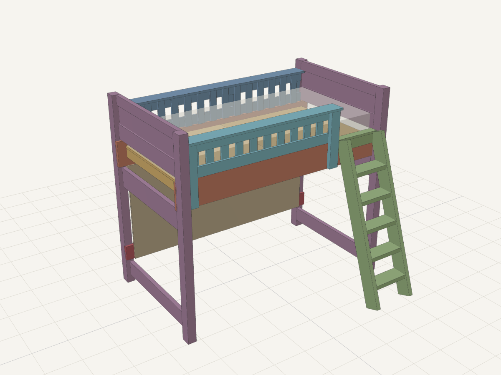
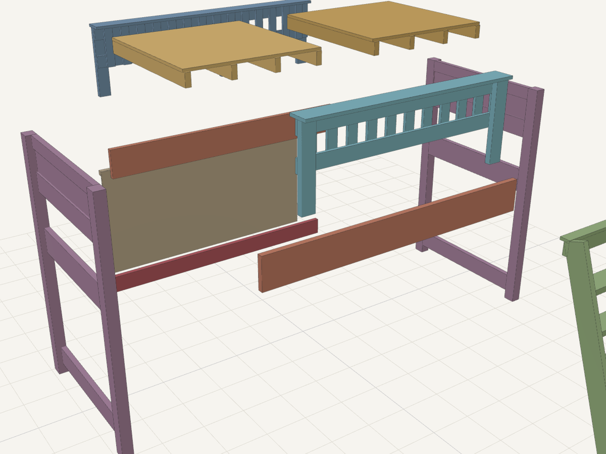

# Nolan's loft bed: design & build guide

A **freestanding** loft bed with a lounge/hideout underneath. It's made from standard S4S
lumber from the big-box store (no rough-cut stock), built around a router, and held together
with **threaded inserts and machine bolts** so it comes apart into flat modules for a truck
or trailer. It's rated for a **300 lb occupant load**, and the strength checks are run at
**600 lb** to allow for kids jumping.

It's inspired by the r/BeginnerWoodWorking loft bunk, which hangs off the walls on 2x6 ledgers.
This one doesn't touch the walls at all.

> Everything in here is generated from `model/bed.py`. Change a parameter (mattress size, deck
> height, ladder angle…), run `model/build.sh`, and the cut list, rail layout, calcs and 3D viewer
> all update together. Open `viewer/index.html` in a browser to orbit, explode and click parts.

---

## 1. Key dimensions (twin, the default)

| | |
|---|---|
| Footprint | **81-3/4" L × 48-1/4" W**, posts 72" tall |
| Mattress pocket | 75-3/4" × 39-1/4" (standard twin 38×75), **8" mattress max** |
| Deck top / mattress top | 54" / 62" |
| Guard cap | 68-1/2" (6-1/2" above the mattress; the bunk-bed standard minimum is 5") |
| Lounge headroom | 46-3/4" under the rails, 49-3/4" under the deck |
| Sitting headroom on top | 34" with an 8 ft ceiling |
| Empty weight | ≈ 317 lb (heaviest single module 50 lb) |

A **full-size** variant (`python3 model/bed.py --full`) is 64-1/4" wide with 5 ribs per deck panel.
Its calcs are in [CALCS.md](CALCS.md).

**Measure before you cut:** ceiling height (you want ≥ 30" from mattress top to ceiling), any
ceiling fan, and which end the ladder goes on. The ladder sits at the foot end of the open
side. To put it at the other end, flip the plan; nothing else changes.

## 2. How it stands up without a wall

A wall-hung loft gets its stiffness from the wall. A freestanding one has to resist being
pushed sideways (**racking**) on its own, in both directions:

| Direction | What resists it |
|---|---|
| **Vertical** | Deck plywood → 2x4 ribs → routed dados in the 2x10 rails → rails bear on **routed housing shoulders** in the posts → posts → floor. Bolts aren't part of the vertical path; it's wood bearing on wood. |
| **Side-to-side** | Two **glued end frames**: posts + 4 mortise-and-tenon rails + a plywood panel. Each one is a rigid ladder. |
| **End-to-end** | The **back shear panel**: 1/2" plywood bolted between the back rail and a back stretcher near the floor. It also makes the back wall of the hideout. |
| **Twisting** | The deck. The rib ends sit in dados in both rails, so the two deck panels form a stiff diaphragm that ties the front to the back wall and the end frames. |

The front (lounge side) stays completely open. Back + two ends + a stiff top makes a
torsionally stable box, like a bookcase with no front.

**Tipping:** empty, it takes about 110 lb of sideways pull at the guard cap to tip it. With a
kid up top it gets more stable, not less. Still, put a **furniture anti-tip strap** from one
post to a wall stud. It carries no load and it's cheap insurance.

## 3. Modules (what goes in the truck)

| Module | Size | Weight | Notes |
|---|---|---|---|
| End frame × 2 | 48-1/4 × 72 × 3 | 50 lb each | Glued for good: 2 posts + lower stretcher, apron, mid rail, top rail, panel |
| Long rail × 2 | 2x10 × 81-3/4 | 18 lb | Rib dados + inserts |
| Back stretcher | 2x6 × 81-3/4 | 11 lb | |
| Back shear panel | 75-3/4 × 36-3/4 | 31 lb | 1/2" ply with 2x2 top cleat glued on |
| Deck panel × 2 | 37-3/4 × 40-1/8 × 4-1/4 | 36 lb each | 3/4" ply glued to four 2x4 ribs |
| Guard (back) | 75-3/4 × 21-1/2 | 23 lb | Glued frame |
| Guard (front) | 58-1/4 × 21-1/2 | 17 lb | Glued frame, ends at the ladder opening |
| Ladder | 17 wide × 58 long | 28 lb | Glued |

Everything is ≤ 82" long, so it fits an 8 ft bed. A 6.5 ft bed works with the tailgate down for
the rails and stretcher. **Eleven pieces, about 40 bolts, all one Allen/hex size per bolt
diameter.**

## 4. The joinery rules

These four rules drove the whole layout:

1. **Bolted joints carry load in wood bearing.** Every bolted member that carries weight sits
   in a 1/2"-deep routed housing (or dado) and rests on its shoulder. The bolts only clamp it
   shut.
2. **Inserts only go into face grain.** That means a board's wide face, never end grain and
   never a narrow 1-1/2" edge (except two lightly loaded 1/4-20s, see J6). The bolt always
   passes *through* the other member to reach the insert.
3. **Long members and end-frame members never share a height band on a post.** On each post's
   inside face the bands are (z from the floor): lower stretcher 3–8.5 · back stretcher
   10–15.5 · apron 38.75–46 · **long rail housing 46.75–56** · mid rail 56.5–62 · panel groove
   62–68.5 · top rail 68.5–72. Nothing in the post collides, which `bed.py` checks for every
   part.
4. **Glue what never comes apart; bolt what does.** End frames, guard frames, deck panels and
   the ladder are glued sub-assemblies. Only the joints *between* modules are bolted.

### Posts
Two 2x4s face-glued into a **3" × 3-1/2"** post. The laminations stack in the length
direction, so each post's inside face (toward the other post in the same end frame) shows the
two 1-1/2" edges, and its x-face (toward the other end of the bed) is one lamination's wide face.

- Pick the straightest 2x4s you can find. Glue, clamp every 8", and let it cure overnight.
- Flush the glue line and ease the corners with a **1/2" roundover** all round. Kids will hug
  these posts.
- **Feet:** a 3/8-16 insert in the bottom of each post takes a **leveling glide**. This is
  end grain, but a glide is only ever in compression. Level the bed on site.
- Solid 4x4 Doug-fir (kiln-dried, S4S) also works, but laminated is straighter and stays straighter.

### End frames (glued, permanent)
- Rails join the posts with **1/2"-thick tenons, 1-1/4" long**. They're flush with the post's
  inner face (the face toward the mattress), so the mortise lands entirely in the inner
  lamination.
- Rails: lower stretcher 2x6, apron 2x8, mid rail 2x6, top rail 2x4. Leave a 1/2" haunch at the
  top of the top-rail tenon so the mortise doesn't break out the top of the post.
- Panel: 1/2" ply in **1/2" × 1/2" grooves** in the mid rail, top rail and both posts. Ply is
  actually about 15/32", so cut the grooves to fit your ply, not to 1/2".
- Optional: cut a shallow arch in the apron with a router template. It's the "doorway" of the
  hideout.
- Glue up on a flat floor and **check the diagonals** before the glue grabs.

### J1: Long rail → post (the main joint)
- **Housing:** a **1/2"-deep × 9-1/4"-tall** step routed across the full 3" width of the post's
  inside face, at z 46.75–56. The rail drops in and sits on the bottom shoulder; the top
  shoulder stops it lifting.
- **Two 3/8-16 inserts in the rail's outer face**, one per lamination and staggered
  (positions in [CUTLIST.md → Long rail layout](CUTLIST.md#long-rail-layout)).
- Bolts go **from the outside of the post**, straight through it, into the rail inserts:
  3/8-16 × 3-3/4" with a fender washer (or 4" in a 1/4"-deep counterbore). The heads are
  outside and easy to reach; nothing is hidden under the mattress.

### J2: Back stretcher → back posts
Same as J1, with a 2x6 in a housing at z 10–15.5.

### J3: Deck ribs → rails (no fasteners)
- Each long rail gets **8 routed dados on its inner face**: 1-9/16" wide (2x4 thickness plus
  1/16"), 1/2" deep, **open at the top and stopped 3" above the bottom edge**.
- Deck panels drop in from above. The rib ends land in the dados and bear on the stopped ends.
  They can't slide lengthwise, so the deck also works as the bed's horizontal brace.
- Panels: 3/4" ply glued and screwed (1-1/4" screws, 6" apart) to four 2x4 ribs on edge. The
  ribs stick out 1/2" past the ply at each end.
- **Ventilation:** route a grid of 1/2"-wide × 6" slots (template + guide bushing) or drill
  1-1/2" holes on a 6" grid. Mattresses on solid ply grow mildew.

### J4: Guard panel → post and rail
- **The 2x4 stiles carry all the bolts. Everything else in the guard is 3/4" pine boards**, since
  none of it carries the bed's weight:
  - **1x4 bottom and top rails**, glued and screwed flat against the stiles' inner (mattress-side)
    face. The bottom rail rests on the long rail's top edge.
  - **1x3 slats**, glued and screwed over both rails on the mattress side. Their inner faces land
    flush with the inside of the mattress pocket.
  - A **1x6 cap** laid flat across the tops of the stiles, rails and slats. It makes a wide,
    comfortable armrest; give it a 1/2" roundover.
- All the pine joints are long grain to long grain (glue plus 1-1/4" screws), so no joinery cuts
  are needed. A slat **spacer block** cut to the gap width sets the spacing. Ease every slat edge
  with a 1/4" roundover before assembly.
- **Clear gap between slats: 2.72–2.80"** (the 3-1/2" maximum is the hard rule).
- Pine is softer than the SPF framing, so the cap check uses #2 Eastern white pine (the weakest
  pine sold as boards). The flat 1x6 cap is at 91% on the front guard's 51" span between stiles,
  under a 200 lb outward push. If you'd like more margin, add a third front stile to the
  `guard("front", ...)` call in `model/bed.py`, keeping its rail inserts clear of the rib dados.
- The panel hangs on the **outer face** of the long rail. Each stile overlaps the rail by about
  9" and takes **two 3/8-16 bolts** (2-1/4") into rail inserts. Stiles next to a post also take
  **two 3/8-16 bolts horizontally through the stile's 3-1/2" width** into inserts in the
  post's x-face (4-1/4" bolts, z ≈ 63" and 66"). That puts them clear of the end-frame
  mortises and panel groove.
- The back guard has a third stile 6" off center, positioned so its inserts miss the deck-seam
  rib dados. The front guard ends in a free stile at the ladder opening.

### J5: Ladder → rail
- Ladder (glued): **2x6 stiles at 70°**, 14" clear between them, **five 2x6 treads** housed in
  1/2" angled dados (routed with a 20° template), glued, two screws per end. Equal 9-1/3" rises,
  and the rail top is the last step.
- A **2x4 header** is let into notches on the backs of the stiles. A 3/4" × 2-3/4" **hook lip**
  is glued along its top edge and hooks over the rail.
- **Three 3/8-16 bolts** (2-1/4") go through the header into front-rail inserts. The hook carries
  the weight; the bolts keep it from lifting off.
- Your grab handles are the post and the end stile of the front guard. Round both over well.

### J6: Back shear panel
- The 1/2" ply is glued and screwed to a **2x2 cleat** along its top. The cleat bolts **up** into
  the back rail's bottom edge with six **1/4-20** bolts (2").
- The bottom of the panel laps the inner face of the back stretcher: six **1/4-20** bolts (1")
  into stretcher inserts.
- These are the only inserts in a narrow edge. They're 1/4-20s (small outside diameter, about
  1/2" of wood on each side), and they're only loaded in shear.

## 5. Router operations & jigs

| Operation | Where | Bit / method |
|---|---|---|
| Rail & stretcher housings | 4 posts (+2 back posts for stretcher) | 3/4" pattern (top-bearing) bit + a 2-fence **housing jig** clamped to the post (two straight 1x4 fences 9-1/4" apart, screwed to a 3/4" ply bridge). Two passes to 1/2" depth |
| Mortises | Posts (16) | 1/2" upcut spiral in a plunge router with an edge guide, or a **mortising jig** (two fences on either side of the post). 1-1/4" deep in 3–4 passes. Square the ends with a chisel or round the tenons |
| Tenons | End rails (8) | Router table with a miter gauge and fence stop, or handheld with a straightedge. 1/2" thick |
| Panel grooves | End rails + posts | Slot cutter or 1/4" straight bit in 2 passes, sized to your ply |
| Rib dados | Long rails (16) | **Dado template**: a ply strip with a slot matched to your guide bushing and bit, held by a fence against the rail's top edge. Stop block at 3" from the bottom |
| Slat & cap edges | Guard slats, caps | 1/4" roundover on slats, 1/2" on the cap (router table) |
| Angled tread dados | Ladder stiles (10) | 20° template + guide bushing. Make the two stiles as a **mirrored pair** |
| Header notches, hook-lip rabbet | Ladder | Straight bit + fence |
| Roundovers | Every exposed edge | 1/2" roundover on posts, caps and ladder; 1/4" everywhere else |
| Apron arch, vent slots | Optional | Template + guide bushing |
| Flattening posts | Optional | Router sled if the glue-up isn't flat |

Make **one housing jig and one dado template** and use them on everything. Lay the posts side by
side and mark all the housings at once, so the bands match exactly.

## 6. Threaded inserts: doing them right

- **Type:** knife-thread or "hex-drive" inserts **made for softwood** (coarse outer thread).
  Use 3/8-16 for structure and 1/4-20 for the back panel. Flanged inserts sit flush and look tidy.
- **Drill square.** Use a drill press for loose parts and a **drill-guide block** (a 2x4 offcut
  with a hole drilled on the drill press) for large parts. A crooked insert means a bolt that
  won't line up on site.
- Use the manufacturer's **softwood pilot size**. Drill **1/4" deeper than the insert** so a bolt
  that's a little long can't bottom out and jack the insert out.
- Drive with a hex key or an insert driver. Don't use the bolt-and-jam-nut trick in softwood;
  it tends to strip.
- Optional: a dab of 5-minute epoxy on the outer threads makes them permanent.
- **Drill the bolt holes through the mating part using the actual assembled joint.** Clamp the
  rail in its housing, drill through the post into the rail with a 3/8" bit to mark the spot,
  pull it apart, then drill the insert pilot at the mark. This beats measuring every time.
- **Pull test before you trust it:** set one insert in a scrap of the rail lumber, thread in a
  bolt, and hang a bucket of sand (or stand on a lever). The calcs assume 300 lb allowable
  withdrawal for 3/8-16. Typical failures are well above that, but check *your* wood and *your*
  inserts.
- Use the same driver for every bolt: **3/8-16 socket-head or hex furniture bolts** with fender
  washers.

## 7. Hardware

| Item | Qty | Use |
|---|---:|---|
| 3/8-16 inserts (softwood) | 41 (incl. 6 spares) | All structural joints, feet |
| 1/4-20 inserts | 16 (incl. 4 spares) | Back shear panel |
| 3/8-16 × 3-3/4" bolts | 12 | Rail→post (8), stretcher→post (4) |
| 3/8-16 × 4-1/4" bolts | 6 | Guard stile→post |
| 3/8-16 × 2-1/4" bolts | 13 | Guard stile→rail (10), ladder header (3) |
| 1/4-20 × 2" bolts | 6 | Panel cleat→rail |
| 1/4-20 × 1" bolts | 6 | Panel→stretcher |
| Fender washers | 1 per bolt | |
| 3/8-16 leveling glides | 4 | Post feet |
| Anti-tip furniture strap | 1 | Post → wall stud |
| Wood glue, 1-1/4" & 2-1/2" screws, finish | | |

Full board and sheet counts are in [CUTLIST.md](CUTLIST.md): about 13 2x4s, 6 2x6s, 1 2x8,
2 2x10s and 1 2x2 for framing, plus 4 1x3s, 4 1x4s and 2 1x6s in pine for the guards (all 8 ft),
and one sheet each of 3/4" and 1/2" ply.

**Cost:** about **$450–720 in materials before tax** for the twin (about $480–780 with Minnesota tax),
plus $130–250 if you need to buy router bits and jig stock. The itemized list is in [COST.md](COST.md).

## 8. Build order

1. **Buy and acclimate** the lumber indoors for a week. Pick straight stock and sight down every board.
2. **Laminate the posts.** Square and trim them to 72".
3. **Lay out all four posts together** (the bands in §4, rule 3) and cut the housings, mortises
   and panel grooves.
4. **End-frame rails:** cut the tenons and grooves. Dry-fit, then **glue up the two end frames**
   flat and square.
5. **Long rails:** cut to length, route the rib dados (template), round over the top edges, and
   set the inserts at the layout positions.
6. **Dry-assemble the frame:** both end frames, then the rails in their housings. Drill the
   rail→post bolt holes through the posts and bolt it up. Add the back stretcher the same way.
7. **Deck panels:** cut the ribs, drop them into the dados, lay the ply on, mark, then glue and
   screw them off the bed. Re-check the fit.
8. **Guards:** route the grooves and tenons and dry-fit. Glue up the frames, fit them to the
   assembled bed, then drill and set the post and rail inserts.
9. **Ladder:** cut the stiles as a pair, route the dados, glue up, fit the header to the rail,
   and set the inserts.
10. **Back shear panel:** glue the cleat on, fit it, and set the 1/4-20 inserts.
11. **Disassemble, sand, round over everything, and finish.** Water-based poly or hardwax oil
    works; let it cure fully before a kid sleeps on it.
12. **Label** the bed (max mattress 8", max load) and stamp a matching number on each side of
    every joint. That makes the trailer reassembly painless.

## 9. Assembly on site (two people, ~30 min)

1. Stand the end frames up and loosely bolt the **back stretcher** between them.
2. Lift both **long rails** into their housings and bolt them finger-tight.
3. Bolt on the **back shear panel** (cleat to the rail first, then the stretcher).
4. Square the frame by measuring corner to corner, then **tighten everything**.
5. Drop in the **deck panels**, then hang and bolt the **guards** and the **ladder**.
6. Level with the glides and fit the **anti-tip strap**.
7. **Re-torque all bolts after 2 weeks**, then every few months. Softwood compresses a little at
   first.

Disassembly is the same in reverse. Strip the deck and guards first, and the rest comes apart
as the six big pieces.

## 10. Safety checklist (bunk-bed rules apply)

ASTM F1427 / 16 CFR 1513 is the US bunk-bed standard, and a loft's upper sleeping surface is
covered the same way. The points this design is built around:

- [x] **Guardrails on all four sides.** Freestanding means there's no wall to stand in for one.
      The ends are the end-frame panels.
- [x] Guard top **≥ 5" above the mattress top**: 6-1/2" with the 8" max mattress. **Label the max
      mattress thickness on the bed.**
- [x] Every opening in the guards and end frames above the mattress is **≤ 3-1/2"**, including
      the guard slats (2.72–2.80") and the gap between rail and guard bottom (none).
- [x] Mattress fits the pocket snugly (≤ 1-1/4" total side play for a standard twin).
- [x] All edges rounded, no protruding bolt ends. Check bolt lengths so nothing sticks out past
      an insert.
- [ ] Upper bunk **not for kids under 6**.
- [ ] Keep the bed away from windows, cords and ceiling fans.

This is a careful hobbyist design with real calcs ([CALCS.md](CALCS.md)). It is not a certified
product. Build it well, check the bolts, and don't lighten members without re-running the model.
